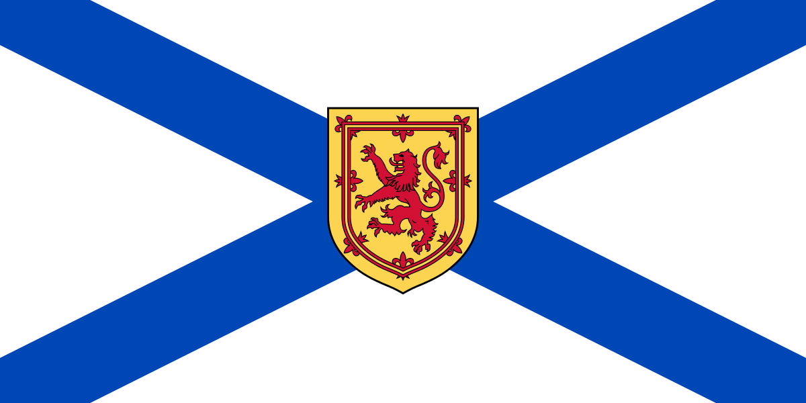

I'm from Halifax, Nova Scotia , Canada .

I'm currently a graduate student in Computer Science at the University of Toronto, supervised by [Alex Mariakakis](https://mariakakis.github.io/) in the [Computational Health and Interaction (CHAI) Lab](https://chai.cs.toronto.edu/)!

My research interests lie in the application of machine learning and ubiquitous computing to enable proactive healthcare and improve patient outcomes.

My Current work includes...

- Multimodal health sensing data collection with heart failure patients at Toronto General Hospital, and open-sourced in the [Auricle Dataset](https://doi.org/10.13026/swme-vp69) for training and evaluating cardiovascular monitoring solutions

- Engineered [PulseKit](https://github.com/chai-toronto/pulsekit), an open-source physiological signal processing library, facilitating low-code analysis of the Auricle Dataset

- Researching remote patient monitoring solutions with wearable devices for individuals with chronic respiratory conditions

- Playing as many intramural sports as possible

- Beating my friends in fantasy football 

I attended the University of Waterloo, where I graduated with a Bachelor of Applied Science in Management Engineering and...

- Did research on numerical optimization techniques for training machine learning models under [Professor Saeed Ghadimi](https://uwaterloo.ca/management-science-engineering/profile/s2ghadim "Professor Saeed Ghadimi")

- Played varsity football for the University of Waterloo Warriors

- Built an AI-powered physician training tool, [Clinical Clarity](https://github.com/thomask902/Clinical-Clarity "GitHub: Clinical Clarity"), for my final-year design project and won a Management Engineering Design Award